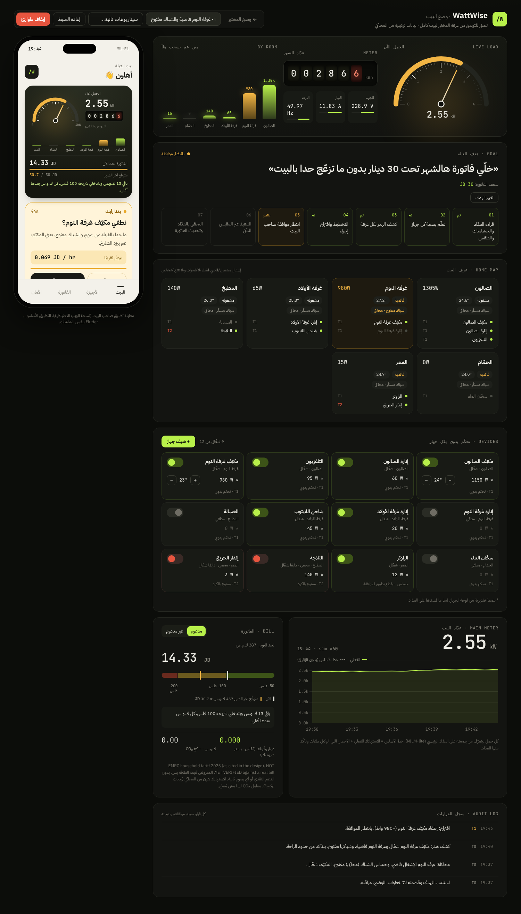
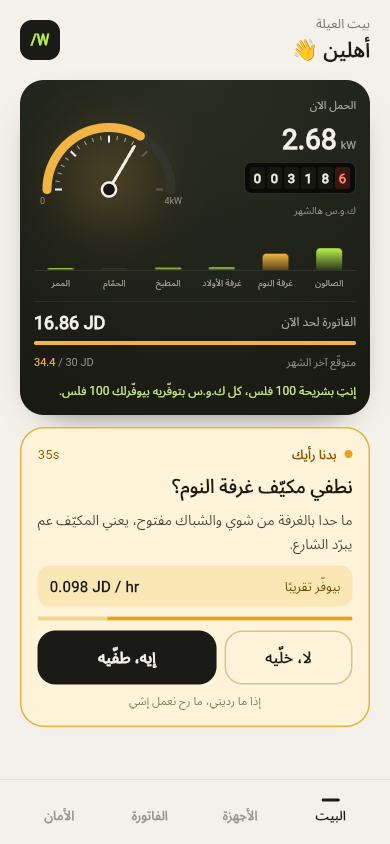

# مقترح مشروع WattWise (واط وايز)
### وكيل ذكاء اصطناعي لتقليل استهلاك الكهرباء في المباني الصغيرة

**المسابقة:** RoboCraft 2.0.0، IEEE RAS، جامعة جدارا (إربد)، ضمن مؤتمر ابتكار جدارا
**المسار:** 02. الاقتصاد الأخضر والطاقة
**المرحلة:** الأولى، المقترح وإثبات المشكلة (آخر موعد 30.11.2026)
**الفريق:** [اسم الفريق] · [أسماء الأعضاء من 2 إلى 4] · [اسم العضو النشط في IEEE ورقم العضوية]

> **ملاحظة للفريق قبل التسليم:** كل نص بين قوسين مربعين `[ ... ]` لازم يتعبّى برقم حقيقي أو يتشال. ما في ولا رقم بهذا المقترح مخترع: كل رقم إما من مصدر رسمي مذكور، أو من الكود الموجود فعلاً، أو مكتوب صراحة إنه «هدف» أو «بانتظار القياس».

---

## 1. الملخّص

WattWise وكيل ذكاء اصطناعي بتعطيه **هدف**، مثل: «قلّل استهلاك هالغرفة 15% هالأسبوع بدون ما تكسر حدود الراحة». الوكيل بيقسّم الهدف لخطوات لحاله، بيقرأ عدّاد كهرباء واحد وحسّاسات بسيطة (وجود ناس، حرارة، إضاءة، باب)، بيتعلّم «بصمة» كل جهاز من قفزة الواط على العدّاد، بيكشف الهدر، بيقترح إجراء مع شرح بالعربي وبالأرقام، **وبيوقف وبيستنّى موافقة الإنسان** على الهاتف. بعد الموافقة بيطفي الجهاز فعلياً عن طريق ريليه، وبيتأكد من العدّاد إنه الاستهلاك نزل، وبيحسب التوفير **المُقاس** بالدينار.

نسبة الـ 15% **هدف تصميمي**، مش نتيجة. ما بنعلن إلا التوفير اللي العدّاد قاسه.

---

## 2. المشكلة، مع الأدلة

### 2.1 الأردن بيستورد أغلب طاقته
- حسب الاستراتيجية الشاملة لقطاع الطاقة 2020–2030 الصادرة عن وزارة الطاقة والثروة المعدنية: «في عام 2018 استورد الأردن تقريباً **93%** من احتياجاته الكلية من الطاقة، بعد ما كانت 97% في 2014». [1]
- نفس الاستراتيجية بتحط هدف **تحسين كفاءة الطاقة 9% بحلول 2030** (سنة الأساس 2018). [1]

يعني كل كيلوواط ساعة بنوفّره هو طاقة أقل بنستوردها وفاتورة أقل على البلد وعلى البيت.

### 2.2 البيوت هي أكبر مستهلك للكهرباء
حسب بيانات هيئة تنظيم قطاع الطاقة والمعادن (EMRC):

| السنة | الاستهلاك الكلي | القطاع المنزلي والاستخدام العام | المصدر |
|---|---|---|---|
| 2023 | 19,113 جيجاواط ساعة | 8,856 جيجاواط ساعة (**46.3%**) | النشرة الإحصائية 2023 للهيئة [2] |
| 2025 | 20,230 جيجاواط ساعة | 9,071 جيجاواط ساعة (**45%**) | بيانات الهيئة لعام 2025 [3] |

- القطاع المنزلي لحاله أكتر من الصناعة (حوالي 18%) والتجاري والفنادق (حوالي 12%) مع بعض. [3]
- عدد المشتركين وصل 2,622,457 مشترك في 2025. [3]
- استهلاك الفرد وصل 1,664 كيلوواط ساعة في 2023، بزيادة 6.3% عن 2022. [2]

### 2.3 الهدر اليومي اللي ما حدا بيلاحظه
أكتر هدر بالبيت مش من الأجهزة نفسها، من **إنها بتضل شغّالة وما حدا محتاجها**: مكيّف شغّال بغرفة فاضية، شباك مفتوح والمكيّف عم يبرّد برّا، لمبة مضوية بالنهار. صاحب البيت ما بيعرف وين بتروح الكهرباء لأنه عنده عدّاد واحد بيعطيه رقم واحد آخر الشهر.

وكمان التعرفة المنزلية بالأردن **بالشرائح**: كل ما زاد الاستهلاك بالشهر، صار سعر الكيلوواط الجاي أغلى. فتوفير شوية كيلوواط بآخر الشهر ممكن يوفّر على البيت أكتر من المتوقع.

### 2.4 أرقامنا الحقيقية (بيتعبّوا قبل التسليم)
| الدليل | القيمة | الحالة |
|---|---|---|
| فاتورة كهرباء حقيقية (بدون أي معلومات شخصية) | الاستهلاك الشهري: [___] ك.و.س · المبلغ: [___] دينار · الشريحة: [___] | **بانتظار صورة الفاتورة** |
| أسعار الشرائح في `config/tariff.json` | مأخوذة من التصميم، بيذكر تعرفة الهيئة المنزلية 2025 | **لازم تتأكد من فاتورة حقيقية** |
| قياس أسبوع بغرفة الاختبار بالعدّاد PZEM-004T | [___] ك.و.س بالأسبوع · ساعات تشغيل بغرفة فاضية: [___] | **بعد وصول القطع** |

---

## 3. الحل: كيف بيشتغل WattWise

### 3.1 الصورة الكاملة

```
حسّاسات ESP32 + عدّاد PZEM  ──HTTP JSON──►  خادم FastAPI  ◄──  المحاكي (نفس الـ API)
                                              │
        ┌──────────────┬──────────────┬───────┴────────┬──────────────────┐
   قاعدة SQLite     حلقة الوكيل     لوحة التحكم      تطبيق الهاتف + صفحة الموافقة
                    (أدوات + مخطِّط)   (رسوم حيّة)      (Flutter + صفحة ويب PWA)
                         │
            حارس السياسات (قواعد ثابتة بالكود، برّا الذكاء الاصطناعي)
                         │
                أوامر الريليه للـ ESP32  ──►  لمبة + مروحة (بدل المكيّف)
```

### 3.2 القطع (أرخص تصميم بيشتغل)
- **ESP32** من عدّة «ESP32 Upgraded Kit».
- **عدّاد طاقة واحد PZEM-004T v3.0** بيقيس كل الدارة: واط، فولت، أمبير، ك.و.س، ومعامل القدرة (PF).
- حسّاس وجود **PIR**، حرارة **DHT11**، ضوء **LDR**، ريليه قناتين (قناة للّمبة وقناة للمروحة)، شاشة LCD، بازر، لمبات LED للحالة.
- **زر يحاكي الباب**: مكتوب بكل مكان إنه محاكاة، وبنحكيها للحكّام بصراحة.
- **زر إيقاف طوارئ** فعلي.
- الجزء اللي فيه 220 فولت بيركّبه **كهربائي مختص** بصندوق مقفل مع قاطع حماية RCBO 30mA.

### 3.3 طبقات الذكاء الثلاث
1. **كشف الشذوذ والهدر:** الوكيل بيعرف شو الطبيعي لكل جهاز حسب الساعة ووجود الناس، وبيلقط الحالات الغلط (مثلاً مروحة شغّالة والغرفة فاضية من فترة).
2. **بصمة الأحمال (NILM مبسّط) والتنبؤ:** عنّا عدّاد واحد بس. لما الريليه يطفي جهاز، القفزة بالواط على العدّاد هي «بصمة» هالجهاز. هيك الوكيل بيعرف قديش كل جهاز بيصرف بدون عدّاد لكل جهاز. وكمان بنقيس **معامل القدرة (PF)** للقفزة: اللمبة حمل مقاومي (PF قريب من 1) والمروحة فيها محرّك (PF أقل)، فحتى لو جهازين قريبين بالواط (لمبة 40 واط ومروحة 45 واط) الوكيل بيفرّق بينهم. وبنضيف تنبؤ قصير المدى بالاستهلاك من الساعة والحرارة والإشعاع الشمسي.
3. **المخطِّط والشارح (نموذج لغوي مع أدوات):** بياخد الهدف ونتائج التحليل والتعرفة وحدود الراحة، بيستدعي الأدوات، وبيطلع بقرار مع **شرح بالعربي البسيط**: السبب، الأرقام، والبديل. إذا الإنترنت أو الـ API وقف، في **وضع بديل بالقواعد** بيكمّل الشغل.

### 3.4 الأدوات اللي بيستعملها الوكيل
| الأداة | شو بتعمل | نوعها |
|---|---|---|
| `read_sensors` | بتقرأ العدّاد والحسّاسات من قاعدة البيانات | حسّاسات + قاعدة بيانات |
| `get_tariff` | سعر الكيلوواط الجاي حسب الشريحة | ملف تعرفة |
| `detect_waste` / `detect_anomaly` | بتلاقي الأجهزة الشغّالة بغرف فاضية | تحليل |
| `get_forecast` | الطقس والإشعاع الشمسي من Open-Meteo (مجاني بدون مفتاح) | API خارجي |
| `forecast_load` | تنبؤ قصير بالاستهلاك | نموذج |
| `request_approval` | بتبعت بطاقة موافقة للهاتف + بازر ولمبة صفرا على الجهاز | رسالة |
| `control_relay` | بتطفي أو بتشغّل الريليه (بعد حارس السياسات) | متحكّم |
| `generate_report` | تقرير التوفير المُقاس | ملف |

---

## 4. كيف بنحقق الشروط الأربعة الإلزامية

| الشرط | كيف بنحققه بـ WattWise | الوضع الحالي |
|---|---|---|
| **1. هدف مش سؤال** | المستخدم بيكتب هدف («قلّل الاستهلاك 15% بدون ما تكسر الراحة»). الوكيل بيقرأ الهدف وبيطلع منه: النسبة المطلوبة (15%)، أو سقف الفاتورة بالدينار، والغرف أو الأجهزة المذكورة، والفترة، وإذا ذكرت الراحة. وبيبني **خطة بتتغيّر حسب الهدف**: بيبدأ بالغرفة اللي ذكرتها، بيشدّد على حدود الحرارة إذا طلبت الراحة، وبيقيس النجاح بالطريقة المناسبة (نسبة مقابل خط الأساس، أو الفاتورة حسب الشرائح). وبتظهر حالة كل خطوة على الشاشة. | **شغّال ومُختبَر** بدون إنترنت (قراءة الهدف بالقواعد، والخطة بتختلف من هدف لهدف). التقسيم بالنموذج اللغوي Claude **مبني ومُختبَر**، وبنجرّبه بمفتاح حقيقي بالمرحلة الثانية. |
| **2. أداتين خارجيتين على الأقل** | العدّاد والحسّاسات، قاعدة بيانات SQLite، ملف التعرفة، متحكّم الريليه، و Open-Meteo للطقس. | الحسّاسات (عن طريق المحاكي) + قاعدة البيانات + ملف التعرفة + التحكم + Open-Meteo **شغّالين**. فيرموير الـ ESP32 **مكتوب** وبينجرّب أول ما توصل القطع. |
| **3. إجراء حقيقي برّا الشات** | بيطفي جهاز فعلي عن طريق الريليه، وبيرنّ البازر، وبيطلع تقرير توفير. | التحكم شغّال على المحاكي. على الريليه الحقيقي **بعد وصول القطع** (المرحلة ب). |
| **4. موافقة الإنسان** | أي إطفاء أو تشغيل لجهاز (الفئة 1) لازم موافقة على الهاتف. **الرفض = ما في إجراء. السكوت = ما في إجراء** (بعد مهلة الموافقة الطلب بينتهي لحاله). | **شغّال ومُختبَر** (اختبارات للموافقة والرفض وانتهاء المهلة). |

---

## 5. الأمان والسياسات (بالكود، مش بإيد الذكاء الاصطناعي)

النموذج اللغوي **بيقترح بس**. القرار النهائي بإيد «حارس السياسات» (`backend/policy.py`)، وهو كود عادي واضح ومُختبَر.

### 5.1 فئات الصلاحيات
| الفئة | أمثلة | مين بينفّذ |
|---|---|---|
| 0، تلقائي | قراءة الحسّاسات، التحليل، التوصيات، التقارير، التنبيهات | الوكيل مباشرة |
| 1، بدها موافقة | إطفاء أو تشغيل اللمبة أو المروحة، تأجيل جهاز | الوكيل، بس بعد موافقة الإنسان |
| 2، ممنوع | الثلاجة، إنذار الحريق، الأجهزة الطبية، إنارة الطوارئ | ولا حدا، ممنوع بالكود |

### 5.2 القواعد اللي الكود بيفرضها
- **قائمة مسموحة:** الوكيل ما بيلمس إلا الأجهزة المسموحة صراحة. الأجهزة الحساسة (مثل الراوتر اللي عليه تطبيق الموافقة) يدوي بس.
- **الأحمال الحرجة** ممنوعة حتى لو صار خطأ بملف الإعدادات (الكود بيفحص نوع الجهاز كمان).
- **حدود الراحة** (حالياً 22 إلى 27 درجة) ما بتنكسر أبداً: ما بنطفي التبريد على ناس بغرفة حامية، وما بنطفي الضو على ناس قاعدين بالعتمة.
- **السكوت مش موافقة:** إذا ما حدا رد خلال المهلة، الطلب بينتهي وما بيصير إشي.
- **إيقاف الطوارئ** (زر فعلي أو زر بالتطبيق) بيوقف الوكيل وبيرجّع الأجهزة لوضعها الطبيعي.
- **وضع آمن عند العطل:** إذا انقطعت القراءات أو صار عطل بحسّاس أو وقف الـ API، الأجهزة بترجع لوضعها الطبيعي وبيكمّل الوضع البسيط بالقواعد.
- **سجل قرارات:** كل قرار، سببه، حالة الموافقة، والنتيجة، بينحفظ وبيظهر بالواجهة.
- **الخصوصية:** حسّاس PIR بيعطي «في ناس / ما في ناس» بس. ما في كاميرات، ما في تتبّع أشخاص، ما في بيانات شخصية.

### 5.3 الإثبات
عنّا **29 اختبار آلي ناجح** بتغطي حارس السياسات، حساب الفاتورة بالشرائح، ومسار الوكيل كامل (اقتراح، موافقة، رفض، انتهاء مهلة، طوارئ، عطل). بتشتغل بأمر واحد: `python -m pytest -q`.

---

## 6. قياس التوفير بطريقة مهنية (M&V)

- ما بنحسب التوفير من «تقدير». بنحسبه **بعد ما العدّاد يأكّد** إنه الاستهلاك نزل فعلاً بعد الإجراء.
- **خط الأساس:** نموذج بيتوقّع قديش كان رح يكون الاستهلاك بدون الوكيل، حسب الحرارة ووجود الناس والساعة. التوفير = المتوقّع بدون الوكيل − الفعلي المُقاس.
- التوفير بيتحسب بالـ **ك.و.س وبالدينار** (حسب الشريحة الحقيقية من الفاتورة)، وبالـ **كغ CO2**.
- **معامل الانبعاثات:** بنستعمل معامل شبكة الأردن من «IFI Dataset of Default Grid Factors v2.0» (2019) المنشور على موقع UNFCCC: **0.516 كغ CO2 لكل ك.و.س** (الهامش المركّب لمشاريع كفاءة الطاقة). [4] الرقم محطوط بملف `config/tariff.json` مع مصدره.

---

## 7. البيانات ومصادرها

| البيانات | المصدر |
|---|---|
| قراءات البيت المحاكى (6 غرف، 12 جهاز) | **بيانات اصطناعية** من المحاكي `simulator/sim.py` |
| قراءات غرفة الاختبار | ESP32 + PZEM-004T + الحسّاسات (المرحلة ب) |
| أسعار الشرائح | تعرفة الهيئة المنزلية، **تتأكد من فاتورة حقيقية بدون معلومات شخصية** |
| الطقس والإشعاع الشمسي | Open-Meteo (بيانات مفتوحة، مجانية) |
| إحصاءات الطاقة الوطنية | وزارة الطاقة وهيئة تنظيم قطاع الطاقة (المراجع تحت) |
| معامل الانبعاثات | IFI / UNFCCC [4] |

ما في أي بيانات شخصية. التفاصيل كاملة بملف `docs/data_sources.md`.

---

## 8. شو مبني لهلّق (نموذج شغّال من غير قطع)

كل هذا شغّال على الكود الموجود بالمستودع وبيشتغل على بيانات المحاكي (88 اختبار آلي ناجحين):
- **الخادم** (FastAPI + SQLite): نفس الـ API للـ ESP32 وللمحاكي، فكود الوكيل نفسه بالحالتين.
- **التوأم الرقمي (المحاكي):** بيت فيه 6 غرف و 12 جهاز، ومبنى مكاتب فيه 10 غرف، وسيناريوهات: غرفة فاضية والشباك مفتوح، موجة حر، عطلة، عطل بحسّاس، حمل غريب.
- **الهدف بكلام عادي:** الوكيل بيقرأ الهدف وبيبني خطة خاصة فيه (بدون إنترنت)، ومع مفتاح Claude النموذج بيبني خطته الخاصة بالأدوات.
- **حلقة الوكيل:** كشف الهدر، فحص حدود الراحة، طلب الموافقة مع شرح بالعربي وبالأرقام (الواط، الدينار بالساعة، الحرارة، البديل)، التنفيذ، والتحقق بالعدّاد.
- **طبقات الذكاء:** كشف الشذوذ (حمل ما بيطابق أي بصمة)، تنبؤ بالاستهلاك مع قياس دقّته كل ساعة، وبصمة الأحمال بالواط ومعامل القدرة.
- **قياس التوفير (M&V):** نموذج خط أساس (الساعة، الإشغال، الحرارة) مع فحوصات ASHRAE Guideline 14، وبيرفض يطلع رقم إذا البيانات مش كافية. وتقرير توفير بيتطبع PDF.
- **حارس السياسات** كامل، مع وضع الطوارئ والوضع الآمن.
- **أوامر بالكتابة أو الصوت، مؤقتات وجداول، «ليش فاتورتي هيك؟» وتقرير أسبوعي**، وكل أمر بيمر على حارس السياسات وبيستنى تأكيد.
- **لوحة تحكم** بالمتصفح فيها رسوم حيّة (Chart.js)، وسجل القرارات، والتوفير المُقاس.
- **تطبيق هاتف** (Flutter) وصفحة موافقة ويب (PWA) كاحتياط.
- **فيرموير الـ ESP32** مكتوب: برنامج اختبار صغير لكل قطعة، والبرنامج النهائي مع زر طوارئ ورجوع آمن إذا انقطع الاتصال.
- **بيشتغل بدون إنترنت** على شبكة محلية أو هوتسبوت الهاتف.

**الجاي (المرحلة الثانية):** تجربة Claude بمفتاح حقيقي، توصيل القطع على جهد منخفض، ثم جهة الـ 220 مع الكهربائي، وقياس أسبوع حقيقي.

| لوحة التحكم مع بطاقة الموافقة | الموافقة من الهاتف |
|---|---|
|  |  |

---

## 9. خطة العرض أمام الحكّام

1. نعرض المشكلة بالأرقام: إحصاءات الأردن + فاتورة حقيقية + قياس أسبوع.
2. لوحة التحكم بتعرض الاستهلاك الحي، وجود الناس، الحرارة، الضو، وحالة الباب (المحاكى).
3. نعطي الوكيل الهدف.
4. نعمل هدر قدّامهم: نغطّي حسّاس PIR («الغرفة فاضية») والمروحة شغّالة.
5. الوكيل بيكشف الهدر وبيعرض تفكيره.
6. بطاقة موافقة بتطلع على الهاتف، والبازر بيرن واللمبة الصفرا بتضوي على الجهاز.
7. بنضغط «موافق»، الريليه بيطفي المروحة فعلياً، والعدّاد بيأكّد النزول.
8. بنعيدها وبنضغط «رفض»، وما بيصير ولا إشي (إثبات الشرط 4).
9. رسم «بدون الوكيل مقابل مع الوكيل» بيعرض التوفير المُقاس.
10. المحاكي بيشغّل بيت كامل ليبيّن إنه الحل بيكبر.

**خطة احتياطية:** شبكة محلية بدون إنترنت، فيديو مسجّل للعرض، وتقرير جاهز مسبقاً.

---

## 10. الجدول الزمني

| التاريخ (2026) | المرحلة | شو بنسلّم |
|---|---|---|
| 21.11 – 30.11 | المرحلة الأولى | هذا المقترح + إثبات المشكلة |
| 01.12 – 15.12 | المرحلة الثانية | النموذج الشغّال: تجربة النموذج اللغوي بمفتاح حقيقي، القطع على جهد منخفض، ثم الكهرباء مع الكهربائي، وقياس أسبوع |
| 17.12 – 26.12 | التقييم والتسليم | تقرير التوفير المُقاس، فيديو العرض |
| كانون الثاني 2027 | النهائي | عرض حي بجامعة جدارا |

---

## 11. الأثر والقابلية للتوسع
- **تكلفة قليلة:** عدّاد واحد بدل عدّاد لكل جهاز، وقطع من عدّة طلاب عادية. التكلفة الكاملة: [___] دينار.
- **بيكبر:** نفس الكود بيشتغل على غرفة وحدة أو بيت كامل أو مبنى صغير (مدرسة، مكتب، مسجد).
- **بيخدم هدف وطني:** تحسين كفاءة الطاقة وتقليل الاستيراد. [1]
- **آمن وموثوق:** الإنسان صاحب القرار، والقواعد الثابتة بالكود بتمنع أي خطأ من الذكاء الاصطناعي.

---

## 12. الشفافية
- البيت المحاكى كله بيانات اصطناعية، وزر الباب محاكاة، وهذا مكتوب بالواجهة وبالوثائق.
- استخدمنا أدوات مساعدة بالبرمجة بالذكاء الاصطناعي، وكل جزء موثّق بملفات «كيف بيشتغل» بالعربي (`docs/explain/`) حتى يقدر الفريق يشرح كل جزء. [تأكيد من المنظّمين إنه هذا مسموح: ___]
- المشروع أصلي ومبني خلال فترة المسابقة.

---

## المراجع
1. وزارة الطاقة والثروة المعدنية، ملخص الاستراتيجية الشاملة لقطاع الطاقة 2020–2030. https://memr.gov.jo/EBV4.0/Root_Storage/EN/EB_Info_Page/Summery_of_the_Comprehensive_Strategy_of_the_Energy_Sector_2020_2030.pdf
2. Jordan Times، «Jordan's per capita electricity use rises to 1,664kWh in 2023»، عن النشرة الإحصائية 2023 لهيئة تنظيم قطاع الطاقة والمعادن. https://jordantimes.com/news/local/jordans-capita-electricity-use-rises-1664kwh-2023
3. Jordan News، «Jordan's Electricity Consumption Falls 0.7% in 2025»، عن بيانات هيئة تنظيم قطاع الطاقة والمعادن (أيلول 2026). https://www.jordannews.jo/Section-112/Economy/Jordan-s-Electricity-Consumption-Falls-0-7-in-2025-55655
4. IFI Dataset of Default Grid Factors v2.0 (تموز 2019)، منشور على موقع UNFCCC. https://unfccc.int/sites/default/files/resource/Harmonized_Grid_Emission_factor_data_set.pdf

> **للفريق:** المرجعين 2 و 3 أخبار بتنقل عن الهيئة. إذا قدرتوا تنزّلوا النشرة الإحصائية نفسها من موقع الهيئة (emrc.gov.jo)، حطّوها بدالهم، أقوى قدّام الحكّام.
